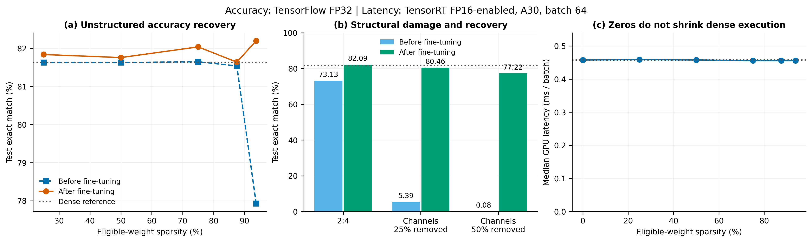
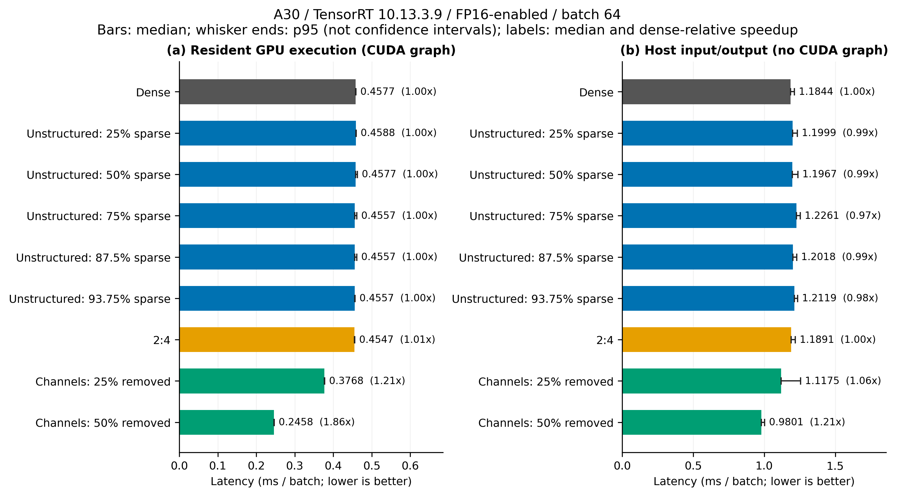
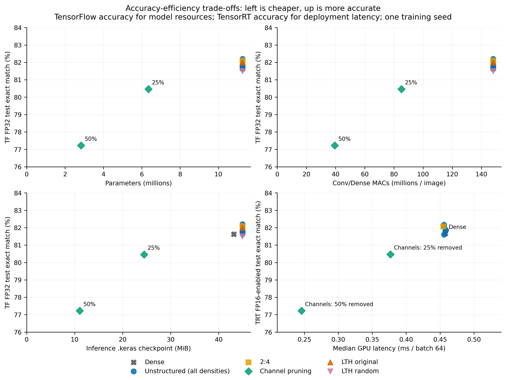
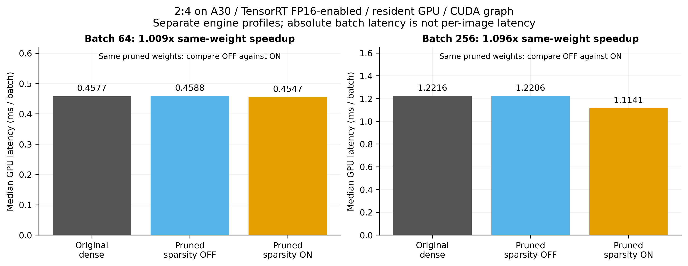
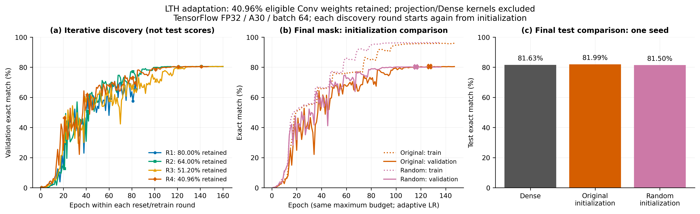

# ResNet-18 pruning: accuracy, trainability and real inference efficiency

A TensorFlow/Keras study of **unstructured pruning, 2:4 sparsity, channel pruning,
and the Lottery Ticket Hypothesis (LTH)** on multi-label MNIST. Deployment is
measured with TensorRT on an NVIDIA A30, not inferred from the number of zero weights.

## Main findings

- **Channel pruning provides the clearest measured acceleration.** Removing 25%
  of stage channels gives **1.21x GPU speedup** with a 1.19 percentage-point
  exact-match accuracy loss. Removing 50% gives **1.86x GPU speedup**, 74.78% fewer
  parameters and 73.36% fewer MACs, with a 4.44-point accuracy loss.
- **Unstructured sparsity is not latency efficiency in this deployment.** Even
  93.75% eligible-weight sparsity preserves accuracy after fine-tuning, but
  TensorRT GPU latency stays around 0.46 ms per batch, essentially unchanged.
- **2:4 acceleration is workload-dependent.** The same-weight sparse-tactic
  comparison gives 1.009x GPU speedup at batch 64 and 1.096x at batch 256;
  batch-256 repeat measurements retain an approximately 1.09x gain against dense.
- **LTH finds a trainable sparse subnetwork, but initialization-specific evidence
  is modest.** At 40.96% retained eligible Conv weights, original initialization
  reaches 81.99% exact match versus 81.50% for random initialization and 81.63%
  for the dense reference. This is one seed, and the original initialization does
  not reach its best epoch sooner than the random control.

GPU speedups above use **resident-buffer TensorRT FP16-enabled inference, CUDA
graphs, A30, batch 64**, except where batch 256 is explicitly stated. They are
not full application speedups. The 50%-channel model's synchronous host-input/output
speedup is **1.21x**, not 1.86x. All conclusions below come from the committed
[result JSONs](results/); no new training or GPU benchmarking is needed to read or plot them.

## Navigation and existing instructions

- [resnet-18.ipynb](resnet-18.ipynb): interactive model training, visualization and evaluation.
- [scripts/README.md](scripts/README.md): **the command reference** for installation,
  baseline reuse, each independent pruning experiment, LTH, GPU/device selection,
  checkpoint handling, ONNX export and TensorRT benchmarking.
- [scripts/RESEARCH.md](scripts/RESEARCH.md): implementation decisions and primary sources.
- `data/`: external `train.pt`, `val.pt` and `test.pt` splits; excluded from Git.
- `models/`: initialization, trained/pruned checkpoints and inference engines; excluded from Git.
- `results/`: one JSON per experiment; intended to be committed to Git.
- [scripts/plot_results.py](scripts/plot_results.py): CPU-only figure regeneration
  directly from the JSONs; outputs are under [scripts/figures/](scripts/figures/).

Run commands from the repository root. Start with the setup and checkpoint
instructions in [scripts/README.md](scripts/README.md). Keep future
experiment-specific commands and supporting code under `scripts/`; keep commands
in `scripts/README.md`, notebooks at the root and measured result JSONs under `results/`.

## Questions and experimental setup

The experiments ask three distinct questions:

1. How much of the trained network can be removed while retaining predictive quality?
2. Which pruning structures actually reduce latency in the target runtime?
3. Can a discovered sparse mask train again from its original initialization,
   and does that initialization help relative to random weights?

### Dataset and reference model

The existing local `.pt` splits contain **50,000 training, 10,000 validation and
10,000 test images**. Images are 64 x 64 grayscale digit compositions, converted
from uint8 to float32 with `/255` scaling and replicated into three channels.
The target is a ten-element multi-hot vector of digit presence. Additional dataset
metadata/targets are not used by this model. The original dataset files must be
provided separately; neither they nor their generator are included in this branch.

The current model is **single-output**, not an auxiliary-task architecture:
7 x 7 stride-2 stem, max pooling, `[2, 2, 2, 2]` residual BasicBlocks with stage
widths `[64, 128, 256, 512]`, projection shortcuts at transitions, global average
pooling, Dense(128, ReLU), Dropout(0.5), and Dense(10, sigmoid).

| Dense reference, TensorFlow FP32 | Measured value |
| --- | ---: |
| Test exact-match accuracy | 81.63% |
| Binary accuracy | 97.592% |
| Precision / recall | 97.923% / 97.437% |
| Binary cross-entropy | 0.12740 |
| Parameters, including non-trainable state | 11,253,066 |
| Conv/Dense MACs per image | 148,112,640 |
| Inference-only `.keras` file | 43.17 MiB |

Source: [baseline.json](results/baseline.json). Exact match requires **all ten
labels** to be correct at threshold `>= 0.5`; binary accuracy averages individual
label decisions and is therefore much less demanding. MACs count Conv/Dense
operations, not every operation or memory transfer; FLOPs are approximately
`2 x MACs` under the multiply-plus-add convention.

### Training and pruning policies

All recorded training experiments use seed 42 and batch 64. LTH uses a 200-epoch
maximum and initial learning rate 0.1; post-training fine-tuning uses a 100-epoch
maximum and LR 0.01. Both use SGD with momentum 0.9, weight decay 0.005 and EMA.
Early stopping monitors validation exact match with patience 20; ReduceLROnPlateau
monitors validation loss with patience 10, factor 0.5 and minimum LR 1e-5.
Thus the policy is shared, but actual stopping epochs and LR trajectories can differ.
The dense training history was not saved in the current benchmark-only baseline
JSON; its historical training schedule cannot be audited from that file alone.

The selected checkpoint is the raw best-validation epoch, explicitly reloaded
after `fit()` finalizes EMA, then saved without optimizer slots. Independent
fine-tuning/retraining runs start with fresh optimizer state.

- **Unstructured:** global magnitude pruning of Conv and hidden Dense kernels;
  biases, BatchNorm and the output kernel are excluded. Each density starts from
  the same trained dense checkpoint, not the previous density's fine-tuned model.
- **2:4:** keep two weights in each group of four along the input-channel/reduction
  dimension. The three-input-channel stem is excluded; `semi24.json` records a
  valid pattern. Persistent masks prevent regrowth in weights and optimizer state.
- **Channels:** magnitude-ranked, shared survivor sets within each residual stage;
  build a genuinely narrower graph and transfer matching Conv, projection,
  BatchNorm and Dense slices. This removes dimensions, not just values.
- **LTH:** prune 20% of surviving eligible Conv weights per round, reset weights
  and BatchNorm state to the original initialization, reset the optimizer, and
  retrain. Projection and Dense kernels are excluded. Train the final mask again
  with random initialization as the control.

**Sparsity denominators differ.** Unstructured pruning has 11,232,448 eligible
weights; 2:4 has 11,223,040; LTH has 10,994,880. Reported sparsity is over each
method's eligible set, not all model parameters. Channel removal is a width
fraction; its compact model can have zero weight sparsity while being much smaller.

## 1. Accuracy before and after fine-tuning

This table uses **TensorFlow FP32 test accuracy throughout**. The dense reference
is 81.63%; retained density and sparsity apply only to the eligible weights.

| Experiment | Eligible-weight sparsity | Before fine-tuning | After fine-tuning | Best / executed epoch |
| --- | ---: | ---: | ---: | ---: |
| Unstructured, density 0.75 | 25.00% | 81.63% | 81.84% | 84 / 100 |
| Unstructured, density 0.50 | 50.00% | 81.63% | 81.76% | 45 / 65 |
| Unstructured, density 0.25 | 75.00% | 81.65% | 82.04% | 71 / 91 |
| Unstructured, density 0.125 | 87.50% | 81.54% | 81.64% | 57 / 77 |
| Unstructured, density 0.0625 | 93.75% | 77.93% | 82.20% | 57 / 77 |
| 2:4 | 50.00% | 73.13% | 82.09% | 68 / 88 |
| Channels, 25% removed | Not applicable | 5.39% | 80.46% | 74 / 94 |
| Channels, 50% removed | Not applicable | 0.08% | 77.22% | 97 / 100 |

Sources: [unstructured results](results/unstructured-75.json),
[50% density](results/unstructured-50.json), [25% density](results/unstructured-25.json),
[12.5% density](results/unstructured-12_5.json), [6.25% density](results/unstructured-6_25.json),
[2:4](results/semi24.json), [channels 25%](results/channels-25.json),
[channels 50%](results/channels-50.json).



**Interpretation.** Magnitude pruning can remove a large fraction of these trained
weights with little immediate damage: even 87.5% sparsity retains 81.54% exact
match before fine-tuning. At 93.75%, fine-tuning recovers 4.27 percentage points,
reaching 82.20%. That supports substantial redundancy for this dataset/model,
but the small improvements over dense do **not** establish pruning as a generalization
improvement: there is only one seed and no equally long, unpruned fine-tuning control.

2:4 has fewer choices about which weights to remove than global pruning, and
its immediate accuracy loss is larger. Fine-tuning recovers 8.96 points. Channel
removal is much more disruptive, but the compact models recover useful accuracy;
fine-tuning is essential rather than an optional small adjustment. The 50%-channel
run uses its entire 100-epoch budget and selects epoch 97; additional training
could be investigated, but recovery to dense accuracy is not demonstrated.

## 2. Matched TensorRT deployment latency

All rows below use **TensorRT 10.13.3.9, A30 GPU 0, FP16-enabled, batch 64,
200 warmups and 5,000 timed repetitions**. Accuracy comes from each TensorRT
engine's full-test evaluation, not from the TensorFlow table above.

- **GPU latency:** CUDA events around inference with resident GPU input/output
  buffers and CUDA graph replay. No model loading, preprocessing or host transfers.
- **Host latency:** synchronous host-input/output inference, including H2D/D2H
  transfers and Python/runner overhead, without graph replay. Preprocessing and
  model loading are still excluded: this is not a full application benchmark.
- Latency is **milliseconds per batch**, not per image. Speedup is
  `dense median / variant median` within the same timing field and conditions.
  Throughput in JSON is `batch size * 1000 / mean latency`, not the median's reciprocal.

| Model | Test exact match | GPU median (ms) | GPU speedup | Host median (ms) |
| --- | ---: | ---: | ---: | ---: |
| Dense | 81.66% | 0.457728 | 1.000x | 1.184450 |
| Unstructured, 25% sparse | 81.87% | 0.458752 | 0.998x | 1.199867 |
| Unstructured, 50% sparse | 81.79% | 0.457728 | 1.000x | 1.196652 |
| Unstructured, 75% sparse | 82.05% | 0.455680 | 1.004x | 1.226060 |
| Unstructured, 87.5% sparse | 81.61% | 0.455680 | 1.004x | 1.201818 |
| Unstructured, 93.75% sparse | 82.17% | 0.455680 | 1.004x | 1.211856 |
| 2:4, sparse tactics enabled | 82.08% | 0.454656 | 1.007x | 1.189133 |
| Channels, 25% removed | 80.47% | 0.376832 | 1.215x | 1.117490 |
| Channels, 50% removed | 77.22% | 0.245760 | 1.863x | 0.980110 |

Sources: [dense](results/latency-dense.json),
[unstructured 25% sparse](results/latency-unstructured-75.json),
[50% sparse](results/latency-unstructured-50.json),
[75% sparse](results/latency-unstructured-25.json),
[87.5% sparse](results/latency-unstructured-12_5.json),
[93.75% sparse](results/latency-unstructured-6_25.json),
[2:4](results/latency-semi24-sparse.json),
[channels 25%](results/latency-channels-25.json),
[channels 50%](results/latency-channels-50.json).



### Unstructured: accuracy retained, latency essentially unchanged

The unstructured models retain the original tensor shapes, allocated parameter
count and dense-equivalent MAC count. Their TensorRT path uses dense tactics;
arbitrary zeros do not cause those kernels to skip the corresponding operations.
Across a 25%-to-93.75% sparsity range, GPU medians remain 0.4557-0.4588 ms,
within about 0.5% of dense. The most sparse model's repeat is 0.454656 ms,
still only a 1.007x dense-relative ratio. This is not meaningful acceleration.

The `.keras` files also do **not** become proportionally smaller: the masked
models occupy about 44.95 MiB versus 43.17 MiB for dense. They still serialize
dense arrays plus mask metadata. A different compressed representation could
reduce storage, but that was not the runtime measured here and would not prove
lower inference latency. High sparsity alone achieves neither a compact dense
graph nor hardware-supported sparse execution.

### Channels: a real but accuracy-dependent deployment improvement

| Model | Residual stage widths | Parameters | MACs / image | `.keras` size (MiB) |
| --- | --- | ---: | ---: | ---: |
| Dense | 64 / 128 / 256 / 512 | 11,253,066 | 148,112,640 | 43.17 |
| 25% channels removed | 48 / 96 / 192 / 384 | 6,348,122 | 85,132,544 | 24.45 |
| 50% channels removed | 32 / 64 / 128 / 256 | 2,837,866 | 39,453,952 | 11.06 |

At 25% removal, parameters fall **43.59%**, MACs **42.52%**, and GPU latency
**17.67%**. At 50% removal, parameters fall **74.78%**, MACs **73.36%**, and GPU
latency **46.31%**. Most convolution kernels depend on both input and output
width, explaining why halving channels removes roughly three quarters of their
weights rather than only half. Fixed layers/state keep the reduction from being exact.

GPU throughput rises from about **139,970 to 169,603 and 260,802 images/s**.
These are batched resident-GPU figures, not request-serving throughput or batch-1 latency.
The measured 1.21x/1.86x GPU speedups are smaller than the MAC-count ratios:
operation counts do not account for kernel efficiency, memory traffic and fixed overhead.

Host medians improve only **5.65% / 17.25%** (1.06x / 1.21x). Also, the
25%-channel model's host p95 is **1.2553 ms**, worse than dense's **1.2121 ms**;
a better median does not establish better tail latency. The 50%-channel model's
host p95 is **1.0026 ms**. GPU and host timings use different execution paths,
so their difference is not a precise estimate of transfer overhead alone.



The resource panels use TensorFlow FP32 accuracy; the latency panel uses TensorRT
accuracy. LTH is absent from the TensorRT panel because no LTH engine benchmark
has been recorded. The visible trade-off is clear: channel pruning moves the
model toward lower compute and latency, at an accuracy cost. Which point is
preferable depends on the application's allowed error and latency budget.

## 3. Does A30 2:4 hardware support translate into speedup?

**Yes, modestly at the larger batch; not materially at batch 64.** A30 supports
sparse Tensor Core execution, but TensorRT may choose dense tactics when they
are faster for a particular layer shape. Hardware support is an opportunity,
not a guaranteed 2x whole-model latency reduction.
[A30 specifications](https://www.nvidia.com/en-us/data-center/products/a30-gpu/),
[TensorRT structured-sparsity requirements and tactic selection](https://docs.nvidia.com/deeplearning/tensorrt/10.x.x/inference-library/io-formats-sparsity.html).

The critical control runs the **same pruned weights with sparsity OFF and ON**.
Comparing only original dense weights against pruned weights would also mix in
weight-dependent engine-building changes.

| Batch | Original dense GPU (ms) | Pruned, sparse OFF (ms) | Pruned, sparse ON (ms) | OFF / ON speedup | Selected sparse layers |
| --- | ---: | ---: | ---: | ---: | ---: |
| 64 | 0.457728 | 0.458752 | 0.454656 | 1.009x | 7 |
| 256 | 1.221632 | 1.220608 | 1.114112 | 1.096x | 14 |

Sources: [batch-64 dense control](results/latency-semi24-dense.json),
[batch-64 sparse](results/latency-semi24-sparse.json),
[matched three-engine batch-256 comparison](results/latency-semi24-batch256.json).
Batch 256 uses its own engine profiles, 200 warmups and 3,000 repetitions.



At batch 256, sparse ON reduces GPU latency **8.72% versus sparse OFF** and
**8.80% versus original dense**. Host latency improves from 2.572490 to
2.469255 ms versus the same-weight control, only **4.01%**. More layers use sparse
tactics at the larger workload, consistent with sparsity becoming worthwhile for
more layer shapes. This is a workload/tactic observation, not proof that batching
alone is the causal mechanism or that every eligible layer accelerated.

Repeat measurements support the scale of the effect:

| Timing repeat | Original dense GPU (ms) | 2:4 GPU (ms) | Dense-relative speedup |
| --- | ---: | ---: | ---: |
| Batch 64 | 0.457728 | 0.453632 | 1.009x |
| Batch 256 | 1.225728 | 1.127424 | 1.087x |

Sources: [dense repeat](results/latency-dense-repeat.json),
[2:4 repeat](results/latency-semi24-sparse-repeat.json),
[batch-256 dense repeat](results/latency-dense-batch256-repeat.json),
[batch-256 2:4 repeat](results/latency-semi24-batch256-repeat.json).
There is no repeated sparse-OFF control at batch 256, so 1.087x is a deployment
comparison against original dense, not a second same-weight tactic ablation.

At batch 256 the sparse engine reaches **82.09% exact match**, versus **81.63%**
for dense. Small FP16/tactic/batch differences in test decisions also occur
across engines, so use each matched result's accuracy rather than silently mixing
the most favorable accuracy and latency from different runs.

## 4. Lottery Ticket Hypothesis: what did resetting actually show?

The [completed LTH result](results/lth-round4.json) is an **adaptation** of
[Frankle and Carbin, ICLR 2019](https://arxiv.org/abs/1803.03635), not an exact
reproduction: dataset, model width, initialization details, SGD/EMA and adaptive
training schedules differ. The relevant test is whether a sparse mask can train
from its initial weights and whether those weights matter relative to a randomized
control under a comparable budget.

### Iterative discovery

Four rounds remove **20% of surviving weights**, not 80% of the entire network
per round: retained density is `0.8^round`. Each round restarts from the original
initialization; it does not continue fine-tuning the previous round's values.

| Round / control | Eligible Conv weights retained | Best validation exact match | Best / executed epoch | Training time (min) |
| --- | ---: | ---: | ---: | ---: |
| Original init, round 1 | 80.00% | 70.67% | 65 / 85 | 38.78 |
| Original init, round 2 | 64.00% | 80.59% | 140 / 160 | 73.13 |
| Original init, round 3 | 51.20% | 80.66% | 140 / 160 | 74.15 |
| Original init, round 4 | 40.96% | 80.53% | 127 / 147 | 67.24 |
| Random init, final round-4 mask | 40.96% | 80.29% | 116 / 136 | 63.15 |

Only the final original/random models have test evaluations. Round 1-3 values
above are **validation scores**, not test accuracy. The jump after round 1 is not
evidence that additional sparsity intrinsically improves learning: both the mask
and the optimization trajectory change, and the first run stops much earlier.

### Final original-initialization versus random-initialization control

Both sparse runs use the **identical final mask**, the same maximum budget,
batch size, optimizer/callback policy, shuffle and Dropout seed. The control's
weight initialization seed is 10042 rather than 42; initial BatchNorm moving
statistics are preserved. Actual LR schedules can diverge because the scheduler
responds to each run's validation loss.

| Final model, TensorFlow FP32 | Test exact match | Binary accuracy | BCE |
| --- | ---: | ---: | ---: |
| Dense reference | 81.63% | 97.592% | 0.12740 |
| Original initialization, 40.96% retained | 81.99% | 97.614% | 0.13048 |
| Random initialization, same mask | 81.50% | 97.572% | 0.13292 |



**What is supported:** a subnetwork with **59.04% of eligible Conv weights masked**
can retrain to dense-level exact-match performance in this run. Original
initialization beats random by **0.49 percentage points**, equivalent to 49 more
correct examples out of 10,000. It also exceeds dense exact match by 0.36 points,
although its BCE is slightly worse; better exact match does not mean every metric improves.

**What is not established:** a robust initialization-specific advantage, faster
learning, cheaper discovery, or a definitive winning-ticket result. The random
control is already close to dense and reaches its selected epoch **11 epochs
sooner** (116 versus 127). Dense learning curves are unavailable, so training
speed relative to dense cannot be established. One discovery seed and one random
initialization do not support statistical significance; aggregate JSON metrics
also do not provide the paired predictions needed for a paired test comparison.

Discovery plus the random control executes **688 epochs and 5.27 hours** of
recorded training time (4.22 hours discovery, 1.05 hours control), excluding the
original dense training and other evaluation/export work. LTH is not a training-cost
reduction demonstrated by these measurements.

Nor is it an inference acceleration result. Dense, original-init and random-init
TensorFlow medians are **7.510 / 7.518 / 7.542 ms per batch**; the models retain
11,253,066 allocated parameters and 148,112,640 dense-equivalent MACs. Both LTH
checkpoints occupy about **44.92 MiB**, including masks. No TensorRT LTH benchmark
is present, and none is inferred from the unstructured results.

The initialization checksum is recorded in the LTH JSON. However, the supplied
baseline is benchmark-only and contains no historical initialization checksum or
training manifest. The script checks compatibility and records explicitly supplied
settings; it cannot independently prove that initialization's historical lineage
or recover missing dense learning curves.

## 5. Overall interpretation and limitations

| Method | What the measurements support | Main limitation |
| --- | --- | --- |
| Unstructured magnitude pruning | High eligible-weight sparsity with recovered accuracy | No meaningful latency gain or smaller dense tensor shapes |
| 2:4 sparsity | Valid masks; modest hardware acceleration at batch 256 | Sparse tactic selection and benefit depend on workload |
| Channel pruning | Smaller dense graphs and clear GPU/host median improvements | Accuracy loss, especially at 50% width removal |
| LTH resetting | Final sparse mask trains to dense-level accuracy; small original-init advantage | One seed, no learning-speed advantage over random, substantial discovery cost |

The central lesson is **sparsity, compactness, trainability and latency are
different properties**. Global pruning demonstrates redundancy; channel pruning
demonstrates practical dense-runtime acceleration; 2:4 demonstrates the importance
of hardware-compatible layout and runtime tactics; LTH investigates initialization
and trainability rather than guaranteeing deployment efficiency.

Important boundaries:

- These are **single-seed training experiments** on one dataset and one GPU model.
  Timing repeats are not independent training seeds. p95 timing is not a confidence
  interval; no seed-variance or significance claim is made.
- Test metrics have been inspected across many exploratory configurations. There
  is no additional untouched confirmation set, and an apparent test-best sparsity
  should not be presented as independently validated model selection.
- Full-test accuracy differs slightly between TensorFlow and FP16-enabled engines.
  Do not mix those evaluations, their BCE values, or their timing paths as if they
  were identical. FP16-enabled does not require every layer to run in FP16.
- TensorFlow timings in training JSONs are short synchronized host-output timings,
  not the later CUDA-event TensorRT protocol. Variability there is not evidence
  that arbitrary zero weights accelerated inference. Use matched TensorRT runs
  for the deployment conclusions above.
- `peak_memory_mb` is TensorFlow allocator peak in the measurement process; earlier
  model/optimizer allocations may remain live. In particular, LTH's increasing
  process peaks are not isolated per-model inference-memory requirements. No
  comparable TensorRT peak-memory or energy/power result is recorded.
- No batch-1, mobile/NPU, INT8 or full-service latency results are available. A30
  batch-64/256 GPU measurements should not be relabeled as edge-device performance.

The most informative follow-ups would be multiple discovery/control seeds, a
matched unpruned fine-tuning control, and batch-1/target-device benchmarking.
They are proposed follow-ups, not completed experiments.

## Reproducing the analysis and finding every artifact

Install the existing dependencies and regenerate figures without loading the
dataset, checkpoints, TensorFlow or CUDA:

```bash
python -m pip install matplotlib numpy
python scripts/plot_results.py
```

The script reads committed JSONs, checks completion status and matched latency
conditions, and recreates the five figures in **PNG (300 DPI), SVG and PDF**.
PNG/SVG files are intended for Git; PDFs are generated for reuse but remain
covered by the repository's existing `*.pdf` ignore rule. It does not modify
result JSONs, rebuild engines or start training. The README's interpretation and
tables describe this result snapshot; after new experiments, regenerate the
figures and review/update the tables and conclusions too.

For the full setup and individual training/export/benchmark commands, use
[scripts/README.md](scripts/README.md). Original `.pt` data and `.keras`/engine
files are external prerequisites for rerunning experiments, but **not** for
regenerating this analysis's figures. Output paths/nonempty model directories
are overwrite-protected; archive an old run or choose new paths when rerunning.

| Result files | Role in this analysis |
| --- | --- |
| [baseline.json](results/baseline.json) | Reused dense FP32 accuracy/resources and batch-64 reference; benchmark-only, no dense training history |
| [benchmark.json](results/benchmark.json) | Earlier dense FP32 **batch-16** measurement (7.2351 ms); same checkpoint, not a batch-64 speed comparison |
| `unstructured-{75,50,25,12_5,6_25}.json` | Five independent densities, immediate/fine-tuned metrics and learning histories |
| [semi24.json](results/semi24.json) | Verified 2:4 pattern and fine-tuning recovery |
| `channels-{25,50}.json` | Compact model widths/resources and pre/post fine-tuning results |
| `latency-dense.json`, `latency-unstructured-*.json`, `latency-channels-*.json` | Matched batch-64 deployment evaluations; `*-repeat.json` files are timing repeats, not new pruning runs |
| `latency-semi24-{dense,sparse}.json` | Same-pruned-weight, sparse-OFF/ON batch-64 comparison |
| `latency-semi24-sparse-repeat.json`, `latency-dense-repeat.json` | Repeated batch-64 dense/2:4 timings |
| [latency-semi24-batch256.json](results/latency-semi24-batch256.json) | Matched three-engine batch-256 comparison, including the sparse-OFF control |
| `latency-{dense,semi24}-batch256-repeat.json` | Repeated original-dense/sparse-ON batch-256 timings |
| [tensorrt-a30.json](results/tensorrt-a30.json) | Earlier host-I/O-only protocol: original dense 1.4371 ms, sparse 1.4270 ms, same-weight ratio 1.007x; no resident-GPU field or recorded graph setting, so excluded from the newer latency chart |
| [lth-round4.json](results/lth-round4.json) | Four discovery histories, final original/random comparison, config and initialization checksum |

## References

- [Frankle and Carbin: The Lottery Ticket Hypothesis (ICLR 2019)](https://arxiv.org/abs/1803.03635).
  This project studies an adaptation, not a reproduction of the paper's CIFAR-10 ResNet experiment.
- [NVIDIA TensorRT 10.x structured sparsity](https://docs.nvidia.com/deeplearning/tensorrt/10.x.x/inference-library/io-formats-sparsity.html).
  Reduction-axis 2:4 requirements and the distinction between eligible and selected sparse tactics.
- [NVIDIA A30 specifications](https://www.nvidia.com/en-us/data-center/products/a30-gpu/).
  Hardware capability is distinct from the model-specific speedups measured here.
- [Implementation sources and methodological notes](scripts/RESEARCH.md),
  [command reference](scripts/README.md), and [raw measurements](results/).
