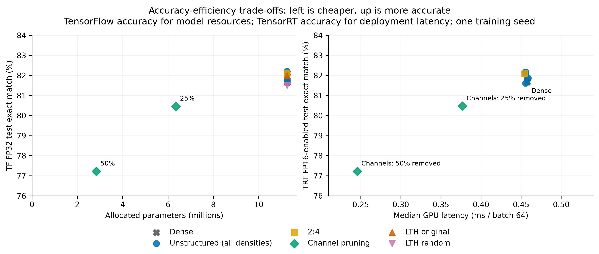

# ResNet-18 Pruning

Four pruning experiments on a TensorFlow/Keras ResNet-18: unstructured magnitude
pruning, 2:4 sparsity, channel pruning, and Lottery Ticket Hypothesis (LTH). The task is multi-label digit classification on 64 × 64 MNIST images,
with ten sigmoid outputs. The splits contain 50,000 training, 10,000 validation
and 10,000 test samples.

The implementation keeps pruning masks fixed during fine-tuning and removes
channels across residual connections. Each experiment has its own script,
with shared code in `scripts/pruning/`. Trained checkpoints are exported through
ONNX for TensorRT inference.

## Results

TensorRT measurements below use version 10.13.3.9 with FP16 enabled on an A30,
batch 64, 200 warmups and 5,000 repetitions. GPU timing uses resident buffers
and CUDA graphs, excluding transfers and preprocessing. Exact match requires
all ten labels to be correct. Parameter counts include zero weights.

| Model | Test exact match | Parameters (M) | GPU median (ms/batch) | GPU speedup |
| --- | ---: | ---: | ---: | ---: |
| Dense | 81.66% | 11.253 | 0.4577 | 1.00× |
| Unstructured, 93.75% sparse | 82.17% | 11.253 | 0.4557 | 1.00× |
| 2:4, sparse tactics enabled | 82.08% | 11.253 | 0.4547 | 1.01× |
| Channels, 25% removed | 80.47% | 6.348 | 0.3768 | 1.21× |
| Channels, 50% removed | 77.22% | 2.838 | 0.2458 | 1.86× |
| LTH original initialization (TF FP32) | 81.99% | 11.253 | N/A | N/A |
| LTH random initialization (TF FP32) | 81.50% | 11.253 | N/A | N/A |

Channel pruning gives the largest latency reduction. Removing 50% of channel
width cuts MACs by 73.36% and drops exact-match accuracy by 4.44 percentage
points. GPU inference is 1.86× faster. Host-input/output timing shows 1.21×
speedup because it includes transfers and runner overhead, without CUDA graphs.

Unstructured pruning keeps accuracy but barely changes latency in TensorRT.
The zeros still run through dense kernels. For 2:4, enabling sparse tactics
on the same weights gives 1.096× GPU speedup at batch 256, well below 2×.

LTH retains 40.96% of eligible convolution weights. Original initialization
scores 0.49 points above the random control, which reaches its best epoch
sooner. The TensorFlow dense reference scores 81.63%. LTH has no TensorRT timings.

All runs use one seed, without an unpruned fine-tuning control.
[results/](results/) contains training histories, all five unstructured
densities, accuracy before and after fine-tuning, and same-weight sparse-tactic
comparisons. [summary.csv](results/summary.csv) separates runtimes and batch sizes.




## Reproduction

Use Linux/WSL2 with a compatible NVIDIA driver for GPU runs. Install the optional
TensorRT dependencies for export and inference benchmarks. Scripts default to
batch 64, GPU 0 and seed 42; pass `--device cpu` for CPU validation.

```bash
conda env create -f environment.yml
conda activate cnn
python -m pip install -r requirements-tensorrt.txt  # optional, for inference/export
python scripts/download_assets.py
```

Checkpoints, masks and dataset splits are on
[Hugging Face](https://huggingface.co/datasets/fucthin/ResNet-18-Pruning-Datasets-and-Models).
The script downloads them into `models/` and `data/`, verifies
[artifacts.json](artifacts.json) checksums and refuses conflicting local files.
Override the source with `--repo OWNER/NAME` or pin it with `--revision COMMIT`.

```bash
# Other retained densities: 0.75, 0.5, 0.25, 0.125; use a fresh output for each.
python scripts/prune_unstructured.py --checkpoint models/dense/model.keras --density 0.0625 --output results/rerun-unstructured.json
python scripts/prune_2to4.py --checkpoint models/dense/model.keras --output results/rerun-semi24.json
python scripts/prune_channels.py --checkpoint models/dense/model.keras --remove 0.5 --output results/rerun-channels.json  # also 0.25
python scripts/lottery_ticket.py --checkpoint models/dense/model.keras --initialization models/dense/initial.keras --baseline results/baseline.json --rounds 4 --prune-rate 0.2 --epochs 200 --learning-rate 0.1 --output results/rerun-lth.json
# Optional fresh baseline; never overwrite the published initialization.
python scripts/train_baseline.py --model-dir models/dense-new --output results/baseline-new.json
```

Fine-tuning runs for up to 100 epochs at LR 0.01, with early stopping and
plateau LR reduction. CLI flags override these settings. Each run needs a new
output path. For a newly trained baseline, pass its checkpoint and matching
`--baseline` JSON to the pruning scripts.

```bash
# TensorFlow evaluation, or matched TensorRT inference for any checkpoint:
python scripts/benchmark.py --checkpoint models/dense/model.keras --output results/rerun-baseline.json
python scripts/benchmark_inference.py --checkpoint models/channels-50/model.keras --warmup 200 --repeats 5000 --output results/rerun-latency.json
# Existing engines: use --engine PATH instead of --checkpoint.
python scripts/export_onnx.py --checkpoint models/dense/model.keras --device cpu --output results/export-dense.json
python scripts/export_onnx.py --checkpoint models/semi24/model.keras --device cpu --output results/export-semi24.json
python scripts/benchmark_tensorrt.py --dense-onnx models/export-dense/model.onnx --sparse-onnx models/export-semi24/model.onnx --batch-size 64 --warmup 200 --repeats 5000 --output results/a30-b64.json
# Repeat the comparison with --batch-size 256 --repeats 3000 and a fresh output.
python scripts/plot_results.py  # four figures + summary.csv; no GPU/models needed
```
